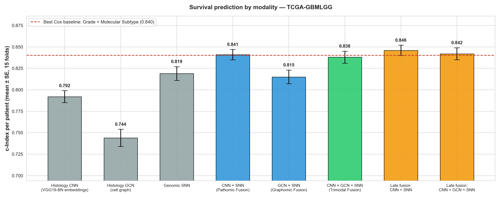
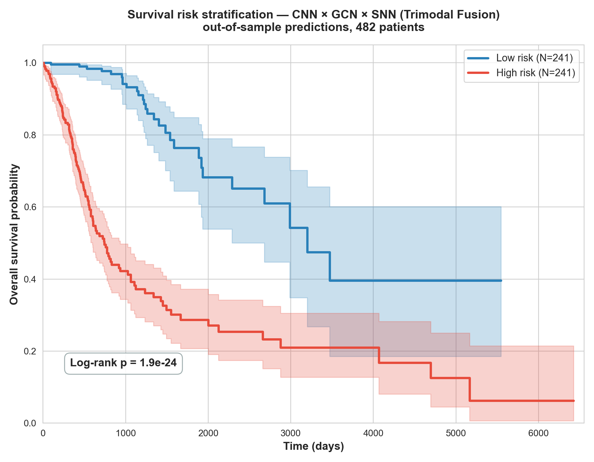
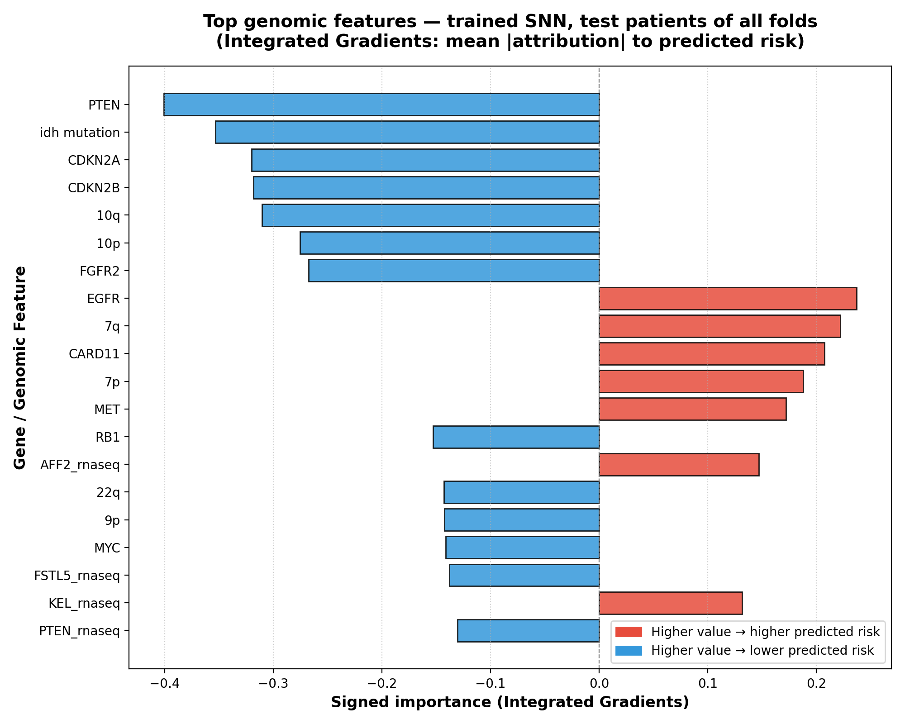

# Multimodal Cancer Prognosis and Grading Using Histopathology Images, Cell Spatial Graphs, and Genomic Features

[](https://www.python.org/downloads/)
[](https://pytorch.org/)
[](https://opensource.org/licenses/MIT)

> **Team Miracle** | **Assam Down Town University**  
> **Team Members:** Anushka Saxena, Aarushi Jain, Ashutosh P. S.  
> *Faculty of Science and Technology, Assam Down Town University, Guwahati, Assam, India*

---

## Summary

This project re-implements and evaluates **Pathomic Fusion** (Chen et al., *IEEE TMI* 2022) on the TCGA-GBMLGG glioma cohort. It predicts patient survival and WHO grade (II / III / IV) from three views of the same tumour:

1. **Histology image** — 32-d embedding of each ROI from a VGG19-BN CNN.
2. **Cell spatial graph** — graph network (GraphSAGE + SAGPool) over the nuclei of an ROI.
3. **Genomic profile** — self-normalising network over 320 features (CNV, IDH mutation, 1p/19q co-deletion, RNA-Seq).
4. **Gated Kronecker-product fusion** of the three embeddings.

All six models (three unimodal, two bimodal, one trimodal) were trained for both tasks over the full **15-fold cross-validation**, and compared with Cox proportional-hazards baselines.

**Main findings (survival, c-Index per patient, 15 folds):**

- Fusing histology and genomics is clearly better than either alone: CNN ⊗ SNN reaches **0.841**, against 0.819 for genomics and 0.792 for histology (better than genomics in 14 of 15 folds).
- The trimodal model reaches **0.838**; adding the cell graph does not improve on CNN ⊗ SNN (difference −0.003, not significant).
- A simple late-fusion average of the histology and genomic models reaches **0.846**, the best result here.
- The fusion models match, but do not beat, a Cox model on pathologist grade + molecular subtype (0.840). They get there without being given the grade.
- Every model equals or exceeds the c-Index published for it in the original paper (the cell-graph GCN is level with it: 0.744 vs 0.746).
- Grade classification: the trimodal and CNN ⊗ SNN models reach an AUC of **0.926**, against 0.920 for histology alone.

---

## Architecture

```
  Histology ROI ──► VGG19-BN CNN ───────────► h_path (32-d) ──┐
                                                              │
  Cell graph ─────► GraphSAGE + SAGPool GCN ► h_grph (32-d) ──┼─► Gated Kronecker ─► MLP ─► survival risk (Cox loss)
                                                              │   product fusion          ─► grade (NLL loss)
  320 genomic ────► 4-layer SNN ────────────► h_omic (32-d) ──┘
  features
```

---

## Methodology

### Data
- **Cohort:** TCGA-GBMLGG (glioblastoma + lower-grade glioma), using the patient splits, ROI embeddings and cell graphs released by the Mahmood Lab with the original paper.
- **Histology:** 1024 × 1024 ROIs from H&E slides. Each ROI is represented by a 32-d embedding from a VGG19-BN CNN trained per fold on training patients only.
- **Cell graphs:** nuclei are nodes (with morphology and texture features) and edges connect spatially neighbouring nuclei.
- **Genomics:** 320 features, made up of copy-number variation, mutation status (IDH, 1p/19q co-deletion) and RNA-Seq expression.
- **Labels:** overall survival time with a censoring flag, and WHO grade II / III / IV.
- **Splits:** the 15 published train/test splits (about 80/20, split by patient so no patient appears in both).

### Models
| Branch | Network | Output |
|---|---|---|
| Histology | VGG19-BN embeddings → MLP (`PathFeatNet`) | 32-d `h_path` |
| Cell graph | GraphSAGE layers + SAGPool, global mean/max pooling | 32-d `h_grph` |
| Genomics | 4-layer self-normalising network (SELU, alpha-dropout) | 32-d `h_omic` |

**Fusion.** Each embedding is gated by an attention gate conditioned on the other modalities. A constant 1 is appended to each, and the outer (Kronecker) product of the gated vectors is taken, which keeps unimodal, bimodal and trimodal interaction terms. The result passes through an MLP (`mmhid = 64`) with skip connections from the unimodal embeddings.

**Heads and losses.**
- Survival: one risk score per sample, trained with the Cox partial-likelihood loss.
- Grade: 3-class softmax, trained with negative log-likelihood.

**Training.**
- Fusion models start from the unimodal SNN and GCN trained on the same fold, kept frozen until `unfreeze_epoch`.
- Adam optimiser with linear learning-rate decay.
- L1 regularisation on the genomic SNN.
- Each fold trains a seed ensemble whose predictions are averaged (5 seeds for feature-based models, 2 for graph-based models).

**Late fusion (an added baseline).** The test-set risk scores (or class probabilities) of separately trained unimodal models are averaged per patient. No joint training is involved.

**Cox baselines.** Cox proportional-hazards models (lifelines) fitted on the training fold and scored on the test fold. Their inputs are histologic grade, molecular subtype, both together, genomic features, and clinical + genomic features.

### Metrics
- **Survival:** concordance index (c-Index), with Kaplan–Meier curves for risk groups split at the median predicted risk.
- **Grade:** macro one-vs-rest AUC, average precision (AP), micro-F1, and F1 for grade IV.
- **Two levels of reporting:**
  - *Per patient* (the primary metric): a patient's ROI predictions are averaged before scoring.
  - *Per ROI*: every ROI is scored as its own sample, as in Chen et al.
- **Paired comparisons:** the per-fold difference between two models, with its mean ± SE and the number of folds won.

### Explainability
Integrated Gradients is applied to the trained genomic SNNs on their own test patients, and attributions are aggregated per feature (`explain.py`).

---

## Contribution relative to Chen et al. (2022)

The network architectures are the ones Chen et al. published, so this work does **not** propose a new fusion model. Its contributions concern reproduction and evaluation:

1. **A full 15-fold reproduction** of all six deep models plus Cox baselines, for both survival and grade, with every result produced from out-of-sample predictions.
2. **Per-patient evaluation** alongside per-ROI evaluation. Per-ROI scores weight patients by their number of ROIs (up to 99).
3. **Leakage-free tuning.** Hyper-parameters are selected on inner validation splits (`tune.py`), and the final epoch is scored with no early stopping on the test fold.
4. **Stronger baselines:**
   - **Late fusion:** CNN + SNN averaging reaches **0.846**, the best survival score here.
   - **Cox baselines:** grade + molecular subtype reaches 0.840 (0.777 in the paper).
5. **A critical finding.** Measured per patient, the trimodal model (0.838) does not beat CNN ⊗ SNN (0.841), late fusion, or the Cox grade + subtype baseline. Measured per ROI, which is the paper's own metric, the trimodal model scores 0.820 against 0.826 published. Most of the improvement over the published numbers comes from the evaluation protocol and the baselines, not from a better trimodal model.

---

## Results

All numbers are mean ± standard error over the 15 test folds. **Per patient** scores average a patient's ROI predictions first and are the primary metric; **per ROI** scores treat every image region as a separate sample, as in the original paper, and are noisier because a few patients contribute up to 99 rows. The last column quotes the value published by Chen et al. (2022) for reference; it is not a result of this project.

### 1. Survival prediction (c-Index)

| Category | Model | Per patient | Per ROI | Paper |
|---|---|:---:|:---:|:---:|
| Cox baseline | Histologic grade | 0.787 ± 0.009 | — | 0.738 |
| | Molecular subtype (IDH + 1p/19q) | 0.796 ± 0.010 | — | 0.760 |
| | Grade + molecular subtype | 0.840 ± 0.009 | — | 0.777 |
| | Genomic features (CNV + mutation) | 0.810 ± 0.009 | — | — |
| | Clinical + genomic features | 0.824 ± 0.009 | — | — |
| Unimodal | Histology CNN | 0.792 ± 0.007 | 0.769 ± 0.016 | 0.792 |
| | Histology GCN (cell graph) | 0.744 ± 0.010 | 0.726 ± 0.022 | 0.746 |
| | Genomic SNN | 0.819 ± 0.008 | 0.808 ± 0.022 | 0.808 |
| Bimodal fusion | CNN ⊗ SNN (Pathomic) | **0.841 ± 0.006** | 0.822 ± 0.020 | 0.820 |
| | GCN ⊗ SNN (Graphomic) | 0.815 ± 0.008 | 0.805 ± 0.023 | 0.812 |
| Trimodal fusion | CNN ⊗ GCN ⊗ SNN | 0.838 ± 0.007 | 0.820 ± 0.021 | 0.826 |
| Late fusion | mean of CNN and SNN risk | **0.846 ± 0.006** | — | — |
| | mean of CNN, GCN and SNN risk | 0.842 ± 0.007 | — | — |

Paired differences over the 15 folds (per patient):

| Comparison | Difference | Folds won |
|---|:---:|:---:|
| CNN ⊗ SNN vs genomic SNN | +0.022 ± 0.005 | 14 / 15 |
| CNN ⊗ SNN vs histology CNN | +0.049 ± 0.007 | 15 / 15 |
| Trimodal vs CNN ⊗ SNN | −0.003 ± 0.004 | 7 / 15 |
| GCN ⊗ SNN vs genomic SNN | −0.004 ± 0.003 | 4 / 15 |
| CNN ⊗ SNN vs Cox (grade + molecular subtype) | +0.001 ± 0.005 | 7 / 15 |
| Late fusion (CNN + SNN) vs Cox (grade + molecular subtype) | +0.006 ± 0.005 | 10 / 15 |

The folds are overlapping random 80/20 splits of the same patients, so these standard errors understate the true uncertainty.

### 2. Grade classification (WHO II / III / IV), per patient

| Model | AUC | AP | Micro-F1 | Grade IV F1 | Paper AUC |
|---|:---:|:---:|:---:|:---:|:---:|
| Histology CNN | 0.920 ± 0.003 | 0.864 ± 0.005 | 0.757 ± 0.009 | 0.914 ± 0.005 | 0.883 |
| Histology GCN (cell graph) | 0.880 ± 0.005 | 0.809 ± 0.007 | 0.682 ± 0.010 | 0.851 ± 0.009 | 0.849 |
| Genomic SNN | 0.858 ± 0.005 | 0.741 ± 0.008 | 0.655 ± 0.008 | 0.861 ± 0.007 | 0.853 |
| CNN ⊗ SNN (Pathomic) | **0.926 ± 0.003** | 0.869 ± 0.006 | 0.752 ± 0.008 | 0.922 ± 0.005 | 0.905 |
| GCN ⊗ SNN (Graphomic) | 0.912 ± 0.004 | 0.848 ± 0.006 | 0.734 ± 0.009 | 0.907 ± 0.005 | 0.897 |
| CNN ⊗ GCN ⊗ SNN (Trimodal) | **0.926 ± 0.004** | 0.869 ± 0.006 | **0.758 ± 0.009** | **0.929 ± 0.005** | 0.908 |
| Late fusion: mean of CNN and SNN probabilities | 0.915 ± 0.003 | 0.854 ± 0.005 | 0.721 ± 0.007 | 0.890 ± 0.004 | — |

Histology dominates grade classification, as expected for a label that pathologists assign from the slide. Fusion adds a small gain over the histology CNN (trimodal +0.006 AUC, better in 13 of 15 folds), and the trimodal and CNN ⊗ SNN models are tied. The cell graph and genomics complement each other strongly: GCN ⊗ SNN is +0.032 AUC over the GCN and +0.054 over the SNN. Per-ROI scores and the remaining columns are in `results/grade_classification_comparison_table.csv`.

### 3. Figures

Every figure is generated from the saved out-of-sample predictions of the trained models.







The Integrated-Gradients ranking is computed with the trained genomic networks on their own test patients. The top features are established glioma markers: IDH mutation and intact *PTEN* / *CDKN2A/B* / chromosome 10 lower the predicted risk, *EGFR* and chromosome 7 gain raise it.

---

## Evaluation protocol

- **15 folds, final epoch.** Each model trains for a fixed number of epochs and the final epoch is scored on the test fold. The test fold is never used for early stopping, checkpoint selection or hyper-parameter choice.
- **Hyper-parameters** of the genomic SNN and of CNN ⊗ SNN were chosen by `tune.py` on inner validation splits carved out of the training folds (`results/tuning/`). The graph-based models use the settings documented by the original authors; the graph fusion models re-use the learning rate and freezing schedule selected for CNN ⊗ SNN.
- **Pre-training.** Fusion networks load the genomic SNN and the GCN trained on the same fold and keep them frozen.
- **Ensembling.** Each fold trains several models with different seeds and averages their predictions (5 for the feature-based models, 2 for the graph-based models).
- **Histology embeddings.** The ROI images were not downloaded (14 GB). The histology branch uses the 32-d embeddings stored in the Mahmood Lab split files, which were produced by a VGG19-BN CNN trained separately on the training patients of each fold. The CNN itself was therefore not re-trained here; `--use_vgg_features 0` trains it end-to-end when the images are present.
- **Grade trimodal split.** The archive has no ROI-level split with histology embeddings for grade classification, so `datasets/make_roi_feature_split.py` builds one by averaging the nine patch embeddings of each ROI.

Known limitations: the hyper-parameters are shared by all folds rather than selected in a fully nested cross-validation; inner validation is optimistic for histology because the stored embeddings come from a CNN that saw all training rows; Grad-CAM is not produced because it needs the ROI images and an end-to-end trained CNN.

The results of the first version of this project (one fold, five epochs) are kept unchanged in `archive/baseline_2026-11-09_fold1_5epochs/`.

---

## Repository structure

```
.
├── config.py                  # command-line options
├── experiments.py             # settings and tuning grids of every model
├── train.py                   # cross-validation training (ensembles, pre-training, parallel folds)
├── test.py                    # re-evaluates saved checkpoints
├── tune.py                    # hyper-parameter selection on inner validation splits
├── run_all.py                 # trains every model for both tasks
├── run_cox_baselines.py       # Cox proportional-hazards baselines
├── analyze_results.py         # tables, late fusion, Kaplan-Meier and comparison plots
├── explain.py                 # Integrated Gradients (genomics), Grad-CAM (histology)
├── download_data.py           # resumable download of splits, graphs and data
├── models/                    # path_net, graph_net, omic_net, fusion, networks (factory)
├── datasets/                  # data_loader, make_splits, make_roi_feature_split
├── utils/                     # loss, metrics, initialization, helpers
├── results/                   # per-fold summaries, tables, figures, tuning grids, logs
└── archive/                   # snapshot of the first version's results
```

---

## Reproduction

```bash
pip install -r requirements.txt

# 1. Data: split files (136 MB), then cell graphs + clinical tables (~0.3 GB)
python download_data.py --target gbmlgg_splits
python download_data.py --target gbmlgg_graphs
python -m datasets.make_roi_feature_split        # ROI-level split for the grade trimodal model

# 2. Cox baselines
python run_cox_baselines.py

# 3. Hyper-parameter selection on inner validation splits (optional; results are in results/tuning)
python tune.py --task surv --mode omic
python tune.py --task surv --mode pathomic
python tune.py --task grad --mode omic
python tune.py --task grad --mode pathomic

# 4. Train everything: feature-based models on CPU in parallel, graph models on GPU
python run_all.py --modes omic,path,pathomic --n_seeds 5 --gpu_ids -1 --cv_workers 7
python run_all.py --modes graph,graphomic,pathgraphomic --graph_n_seeds 2

# 5. Tables, figures, explainability
python analyze_results.py
python explain.py
```

A single model can be trained or re-evaluated directly, for example:

```bash
python train.py --mode pathomic --model_name pathomic --task surv --use_rnaseq 1 --use_vgg_features 1 --reg_type none --batch_size 64 --niter_decay 30 --lr 1e-4 --unfreeze_epoch 0 --n_seeds 5
python test.py  --mode pathomic --model_name pathomic --task surv --use_rnaseq 1 --use_vgg_features 1
```

---

## Authors

- **Team Miracle** — Anushka Saxena, Aarushi Jain, Ashutosh P. S.
- **Institution:** Assam Down Town University, Guwahati, Assam, India

---

## References
- Chen, R. J., Lu, M. Y., Wang, J., Williamson, D. F. K., Rodig, S. J., Lindeman, N. I., & Mahmood, F. (2022). *Pathomic Fusion: An Integrated Framework for Fusing Histopathology and Genomic Features for Cancer Diagnosis and Prognosis*. **IEEE Transactions on Medical Imaging**, 41(4), 757–770. [DOI: 10.1109/TMI.2020.3021387](https://doi.org/10.1109/TMI.2020.3021387)
- Mobadersany, P., et al. (2018). *Predicting cancer outcomes from histology and genomics using convolutional networks*. **PNAS**, 115(13), E2970–E2979.
- Klambauer, G., et al. (2017). *Self-Normalizing Neural Networks*. **NeurIPS**, 971–980.
- Hamilton, W., Ying, Z., & Leskovec, J. (2017). *Inductive Representation Learning on Large Graphs*. **NeurIPS**, 1024–1034.
