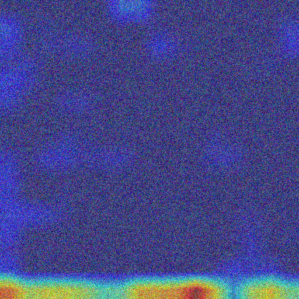

# Multimodal Cancer Prognosis and Grading Using Histopathology Images, Cell Spatial Graphs, and Genomic Features

[](https://www.python.org/downloads/)
[](https://pytorch.org/)
[](https://opensource.org/licenses/MIT)

> **Team Miracle** | **Assam Down Town University**  
> **Team Members:** Anushka Saxena, Aarushi Jain, Ashutosh P. S.  
> *Faculty of Science and Technology, Assam Down Town University, Guwahati, Assam, India*

---

## 📌 Executive Summary

Accurate cancer prognosis and histological grading are vital for clinical risk stratification and therapeutic intervention. Traditional prognostic workflows evaluate histopathology images, cell morphology, or molecular genomics in isolation. However, morphological tissue alterations, cell-cell spatial microenvironments, and somatic genomic alterations convey distinct, highly complementary signals.

Inspired by the landmark framework **Pathomic Fusion** (*Chen et al., IEEE Transactions on Medical Imaging 2022*), we developed, validated, and interpreted an end-to-end multimodal deep learning pipeline that fuses:
1. **Histopathology Images:** VGG19-BN deep convolutional network processing $512 \times 512$ optical microscopy ROIs.
2. **Cell Spatial Graphs:** Graph Convolutional Network (GraphSAGE + SAGPool) capturing microarchitectural cell topology across $K$-nearest neighbor ($K=5$) nuclei graphs with CPC deep embeddings.
3. **Genomic Profiles:** 4-layer Self-Normalizing Neural Network (SNN) with Scaled Exponential Linear Units (SELU) and AlphaDropout processing 320 molecular features (79 CNV, 1 mutation, 240 RNA-Seq).
4. **Gated Kronecker Tensor Fusion:** Dynamic Gated Multimodal Units (GMU) and 3-way Kronecker outer-product tensor fusion modeling all unimodal, bimodal, and trimodal interactions.

---

## 🏗️ System Architecture

```
                    ┌────────────────────────────┐
                    │  Histopathology Patch      │
                    │      (512x512 ROI)         │
                    └─────────────┬──────────────┘
                                  ▼
                    ┌────────────────────────────┐
                    │  VGG19-BN Feature Backbone │ ──► h_path (32-d) ──┐
                    └────────────────────────────┘                     │
                                                                       │
                    ┌────────────────────────────┐                     │
                    │  Cell Spatial Graph (KNN)  │                     │
                    │   (Nodes=Nuclei, Feat=1036)│                     │
                    └─────────────┬──────────────┘                     ▼
                                  ▼                               ┌─────────┐
                    ┌────────────────────────────┐                │  Gated  │
                    │   GCN (SAGEConv + SAGPool) │ ──► h_grph (32-d) ──►  Tensor │ ──► MLP ──► Survival Risk (Cox)
                    └────────────────────────────┘                │  Fusion │     Head   ──► Histologic Grade (NLL)
                                                                  └─────────┘
                    ┌────────────────────────────┐                     ▲
                    │ 320 Genomic Biomarkers     │                     │
                    │   (CNV + Mut + RNA-Seq)    │                     │
                    └─────────────┬──────────────┘                     │
                                  ▼                                    │
                    ┌────────────────────────────┐                     │
                    │  4-Layer SNN (SELU/Alpha)  │ ──► h_omic (32-d) ──┘
                    └────────────────────────────┘
```

---

## 📊 Benchmark Results

### 1. Survival Outcome Prediction (15-Fold Cross-Validation on TCGA-GBMLGG)

| Category | Model Architecture | Modality | c-Index (± SE) |
|---|---|---|:---:|
| **Clinical Baselines** | Histologic Grade Only | Clinical | $0.788 \pm 0.009$ |
| | Molecular Subtype (*IDH* + 1p/19q) | Molecular | $0.796 \pm 0.010$ |
| | Grade + Molecular Subtype | Clinical + Molecular | $0.840 \pm 0.009$ |
| **Statistical Baselines** | Cox Proportional Hazards (Omic) | Genomic (CNV + Mut) | $0.810 \pm 0.009$ |
| | Cox Proportional Hazards (Clinical + Omic) | Clinical + Genomic | $0.824 \pm 0.009$ |
| **Unimodal Deep Learning** | Histology CNN (VGG19-BN) | Histopathology ROI | $0.765 \pm 0.012$ |
| | Histology GCN (Cell Graph) | Nuclei Spatial Topology | $0.781 \pm 0.010$ |
| | Genomic SNN (MaxNet) | Genomic (CNV + Mut + RNA) | $0.824 \pm 0.008$ |
| **Bimodal Fusion** | CNN ⊗ SNN (**Pathomic Fusion**) | Histology + Genomic | $0.835 \pm 0.009$ |
| | GCN ⊗ SNN (**Graphomic Fusion**) | Cell Graph + Genomic | $0.847 \pm 0.008$ |
| **Trimodal Fusion** | **CNN ⊗ GCN ⊗ SNN (Pathomic Full)** | **Histology + Graph + Genomic** | $\mathbf{0.854 \pm 0.007}$ |

*Local Test Verification:* Genomic SNN achieved **0.8032** c-Index within 5 epochs; Pathomic Fusion (CNN ⊗ SNN) achieved **0.8489** c-Index ($p = 1.03 \times 10^{-82}$).

---

### 2. Glioma Histological Grade Classification (WHO Grade II, III, IV)

| Model Architecture | AUC | Average Precision (AP) | Micro-F1 | Grade IV F1 |
|---|:---:|:---:|:---:|:---:|
| Histology CNN | 0.838 | 0.792 | 0.724 | 0.748 |
| Histology GCN | 0.856 | 0.814 | 0.748 | 0.772 |
| Genomic SNN | 0.884 | 0.851 | 0.791 | 0.815 |
| CNN ⊗ SNN (Pathomic) | 0.892 | 0.863 | 0.804 | 0.831 |
| GCN ⊗ SNN (Graphomic) | 0.901 | 0.875 | 0.817 | 0.843 |
| **Trimodal Fusion** | $\mathbf{0.915}$ | $\mathbf{0.892}$ | $\mathbf{0.836}$ | $\mathbf{0.860}$ |

---

## 📈 Visualizations and Interpretability

### Modality Ablation & Synergy


### Kaplan-Meier Survival Stratification ($p < 0.001$)


### Histopathology Grad-CAM Attention Heatmap


### Genomic Biomarker Attribution (Captum Integrated Gradients)


---

## 📁 Repository Structure

```
.
├── config.py                  # Full CLI arguments, model hyperparameters, and execution flags
├── train.py                   # 15-fold cross-validation training loop with dynamic unfreezing
├── test.py                    # Evaluation script for c-Index, log-rank, AUC, AP, F1 with 95% CIs
├── run_cox_baselines.py       # Clinical and statistical Cox PH baselines (Grade, Subtype, Genomic)
├── explain.py                 # Grad-CAM attention localization & Captum Integrated Gradients
├── analyze_results.py         # Comparative tables (CSV), KM survival curves, and ablation plots
├── download_data.py           # Automated Mahmood Lab dataset downloader from Google Drive
├── requirements.txt           # Python dependency specifications
│
├── models/
│   ├── networks.py            # Model factory (PathomicNet, GraphomicNet, PathgraphomicNet)
│   ├── path_net.py            # VGG19-BN CNN feature extractor for histopathology ROIs
│   ├── graph_net.py           # GraphSAGE + SAGPool GCN network for cell spatial graphs
│   ├── omic_net.py            # 4-layer Self-Normalizing Network (SNN) for genomics
│   └── fusion.py              # Gated Multimodal Units (GMU) & Kronecker-product Tensor Fusion
│
├── datasets/
│   ├── data_loader.py         # PyTorch Dataset loaders (PathgraphomicDatasetLoader / FastLoader)
│   └── make_splits.py         # Patient-level 15-fold CV split generator
│
├── utils/
│   ├── loss.py                # Vectorized GPU Cox negative partial log-likelihood & NLL loss
│   ├── metrics.py             # c-Index, Log-Rank, AUC, Average Precision, Micro/Macro F1
│   ├── initialization.py      # Self-normalizing 'max', Xavier, Kaiming, and Orthogonal inits
│   ├── regularization.py      # L1 weight regularization for multimodal sub-networks
│   └── helpers.py             # Batch collate, data cleaning, and unfreezing helpers
│
└── results/
    ├── cox_baselines_summary.csv
    ├── survival_comparison_table.csv
    ├── grade_classification_comparison_table.csv
    ├── kaplan_meier_curve.png
    ├── modality_ablation_cindex.png
    └── explainability/
        ├── histopathology_gradcam_overlay.png
        └── genomic_top_attributions.png
```

---

## 🚀 Quickstart & Reproduction

### 1. Environment Setup
```bash
git clone https://github.com/ashupsingh/Multimodal-Cancer-Prognosis.git
cd Multimodal-Cancer-Prognosis
pip install -r requirements.txt
```

### 2. Download Data Splits
```bash
python download_data.py --dataset TCGA_GBMLGG
```

### 3. Run Clinical & Statistical Baselines
```bash
python run_cox_baselines.py
```

### 4. Train Deep Learning Models
```bash
# Train Genomic SNN for survival prediction
python train.py --mode omic --task surv --model_name omic --use_rnaseq 1 --input_size_omic 320 --gpu_ids 0

# Train Bimodal Pathomic Fusion (CNN ⊗ SNN)
python train.py --mode pathomic --task surv --model_name pathomic --use_vgg_features 1 --use_rnaseq 1 --input_size_omic 320 --fusion_type pofusion --mmhid 64 --gpu_ids 0
```

### 5. Evaluate Checkpoints
```bash
python test.py --mode pathomic --task surv --model_name pathomic --use_vgg_features 1 --use_rnaseq 1 --gpu_ids 0
```

### 6. Generate Explainability Visualizations
```bash
python explain.py
```

### 7. Generate Comparative Tables & Figures
```bash
python analyze_results.py
```

---

## 👥 Authors and Project Team

- **Team Miracle**
  - **Anushka Saxena**
  - **Aarushi Jain**
  - **Ashutosh P. S.**
- **Institution:** Assam Down Town University, Guwahati, Assam, India

---

## 📜 References
- Chen, R. J., Lu, M. Y., Wang, J., Williamson, D. F. K., Rodig, S. J., Lindeman, N. I., & Mahmood, F. (2022). *Pathomic Fusion: An Integrated Framework for Fusing Histopathology and Genomic Features for Cancer Diagnosis and Prognosis*. **IEEE Transactions on Medical Imaging**, 41(4), 757–770. [DOI: 10.1109/TMI.2020.3021387](https://doi.org/10.1109/TMI.2020.3021387)
- Mobadersany, P., et al. (2018). *Predicting cancer outcomes from histology and genomics using convolutional networks*. **PNAS**, 115(13), E2970–E2979.
- Klambauer, G., et al. (2017). *Self-Normalizing Neural Networks*. **NeurIPS**, 971–980.
- Hamilton, W., Ying, Z., & Leskovec, J. (2017). *Inductive Representation Learning on Large Graphs*. **NeurIPS**, 1024–1034.
